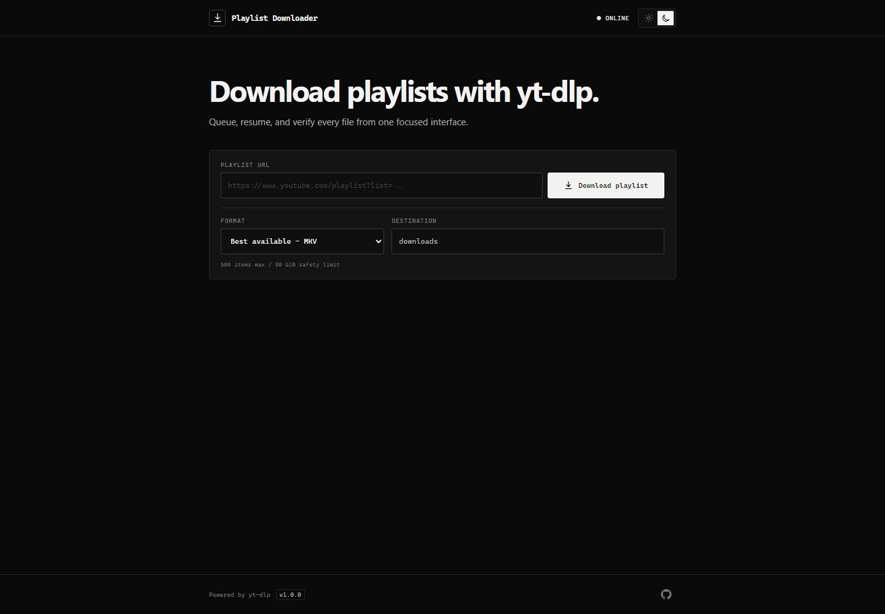

# Playlist Downloader UI

An independent, secure, and resumable UI and orchestration layer for [`yt-dlp`](https://github.com/yt-dlp/yt-dlp), built with React and Express. Each playlist is stored in one flat folder and verified with `ffprobe` after download.

> Download only media you are permitted to save. You are responsible for complying with YouTube's terms and applicable law.



## Features

- Best available, 1080p, and 720p quality profiles
- Live speed, ETA, item, pass, and total progress over SSE
- Collapsible queue that appears only after a playlist URL is entered
- Resume-aware retries, archive tracking, and final media verification
- Configurable storage, app identity, quality, resource limits, ports, and tool paths
- Authenticated Docker/Render mode with browser retrieval for verified files
- Dark and light responsive UI with keyboard and reduced-motion support
- Loopback-only backend with strict origin, input, filesystem, and process controls

## Requirements

- Node.js 20.19 or newer
- Current `yt-dlp`
- `ffmpeg` and `ffprobe`

The three media tools can be on `PATH`, or configured using absolute paths in `.env`.

## Quick start

```powershell
git clone https://github.com/LakshayKhattar/playlist-downloader-ui.git
cd playlist-downloader-ui
Copy-Item .env.example .env
npm ci
npm run verify
npm start
```

Open <http://127.0.0.1:4173>. Downloads default to `downloads/<playlist-id>/` and remain resumable after a cancel or restart.

For development, run the backend and Vite in separate terminals:

```powershell
npm run dev:server
npm run dev
```

## Configuration

Copy [`.env.example`](.env.example) to `.env`. All settings are optional and have safe defaults. Common settings are:

| Setting | Default | Purpose |
| --- | --- | --- |
| `APP_NAME` | `Playlist Downloader` | Name shown in the UI and page title |
| `DEFAULT_QUALITY` | `best` | `best`, `1080`, or `720` |
| `PLAYLIST_DOWNLOADS_ROOT` | `<app>/downloads` | Absolute persistent output directory |
| `PORT` / `DEV_PORT` | `4173` / `5173` | Backend and Vite development ports |
| `APP_PUBLIC_URL` | empty | Exact HTTPS reverse-proxy origin for hosted use |
| `BIND_HOST` | `127.0.0.1` | Loopback locally; `0.0.0.0` only in authenticated remote mode |
| `ALLOW_REMOTE_ACCESS` | `false` | Explicitly enables traffic through a hosting proxy |
| `APP_AUTH_USERNAME` | `playlist` | Username used when password protection is enabled |
| `APP_AUTH_PASSWORD` | empty | Required secret when remote access is enabled |
| `YT_DLP_BIN` | auto-detected | Absolute `yt-dlp` executable path |
| `FFMPEG_BIN` / `FFPROBE_BIN` | auto-detected | Absolute media-tool paths |

The example file documents the complete resource-limit configuration.

## Verification

```powershell
npm run verify
npm run test:ui
```

`verify` runs backend tests, a production frontend build, and the offline high-severity dependency audit. The UI test exercises the production app without downloading media. A deliberately bounded real-download smoke test can be run with:

```powershell
npm run test:ui -- "https://www.youtube.com/playlist?list=PLAYLIST_ID"
```

## Deployment

This app requires a long-running Node process, SSE connections, media executables, and writable storage. It is not compatible with static-only or serverless hosting. The included Render Blueprint uses the free tier and temporary storage; save verified files through the UI before the service resets.

- [DEPLOY.md](DEPLOY.md): complete zero-cost Docker deployment on Render, including free-tier limits
- [GUIDE.md](GUIDE.md): local staging and same-origin VPS deployment with systemd and Caddy

Local and VPS deployments bind to `127.0.0.1` by default. Render mode binds publicly only when an exact HTTPS origin and password authentication are configured. See [SECURITY.md](SECURITY.md) for the security boundary and reporting policy.

## Credits

The download engine is the open-source [`yt-dlp`](https://github.com/yt-dlp/yt-dlp) project, maintained by the yt-dlp contributors. Media inspection and merging are provided by [FFmpeg](https://ffmpeg.org/). This repository supplies an independent web UI, job-management layer, safety controls, and verification workflow; it is not affiliated with or endorsed by yt-dlp, FFmpeg, or YouTube.

## License

[MIT](LICENSE)
